# Vela for iOS

A native iPhone port of Vela Maps: the same open map, the same keyless Google search, place data
and traffic-aware routes, and turn-by-turn navigation, rebuilt in Swift. There is no Google SDK,
no API key and no account, and no Vela server. GPLv3, like the Android app.

> [!warning]
> This is an early port. It runs on a phone and has been checked in the simulator and on one
> device, but it has not been taken on long drives yet. Expect bugs.

## Screenshots

| Map | Search results | Place | Save to a list |
|:-:|:-:|:-:|:-:|
| 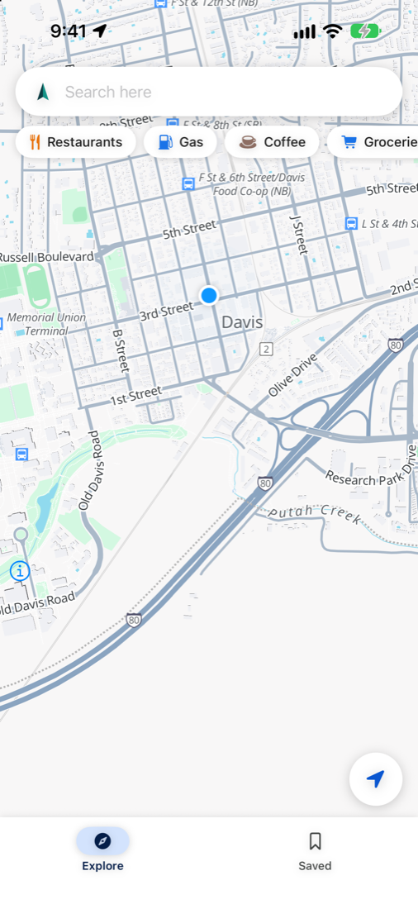 | 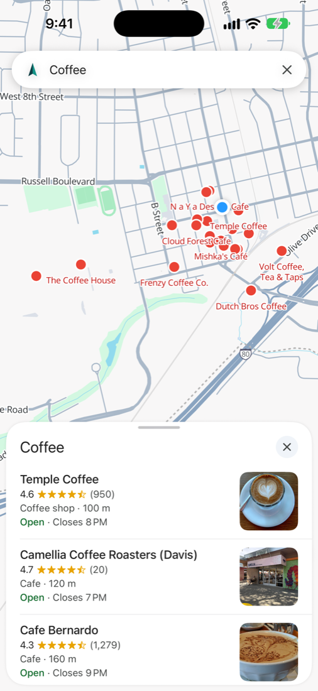 | 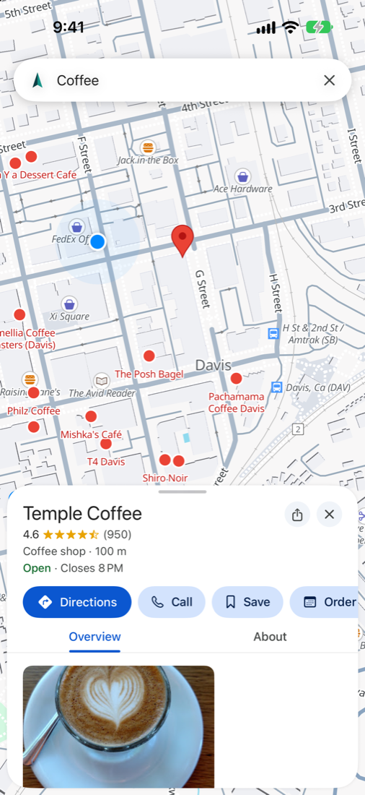 | 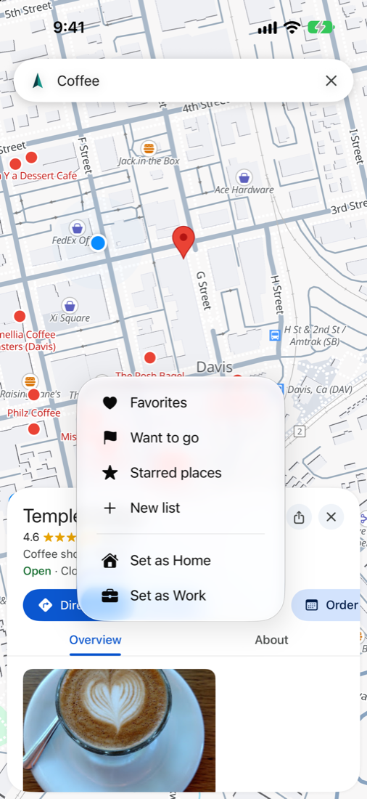 |

| Saved, Home and Work | Search | Autocomplete | Directions |
|:-:|:-:|:-:|:-:|
| 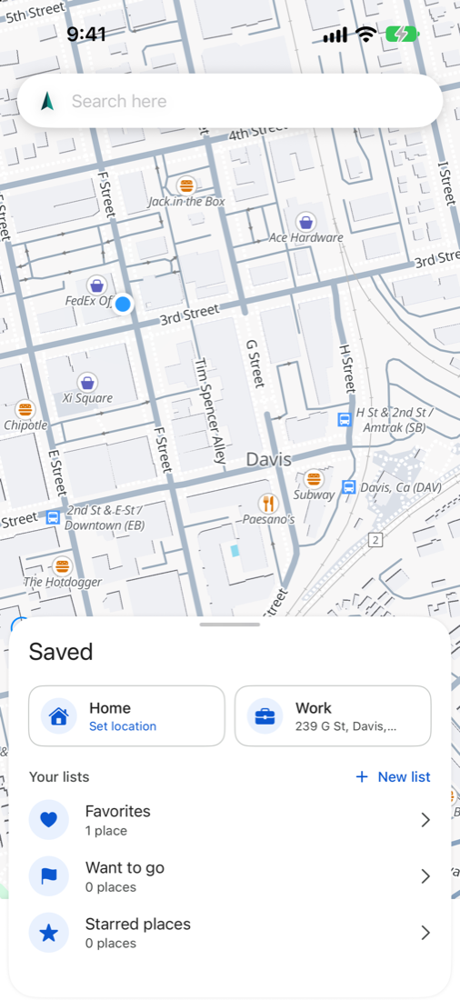 | 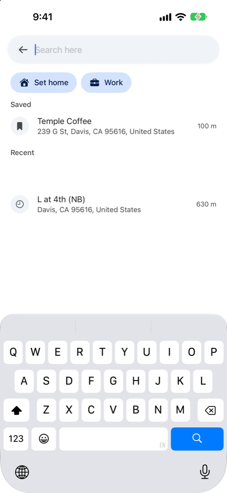 | 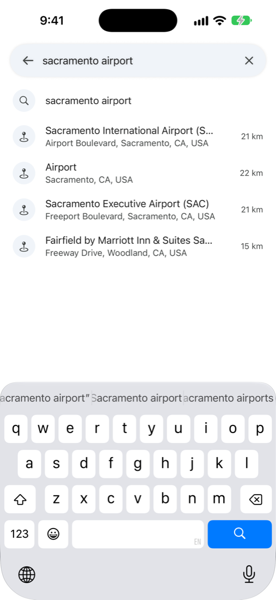 | 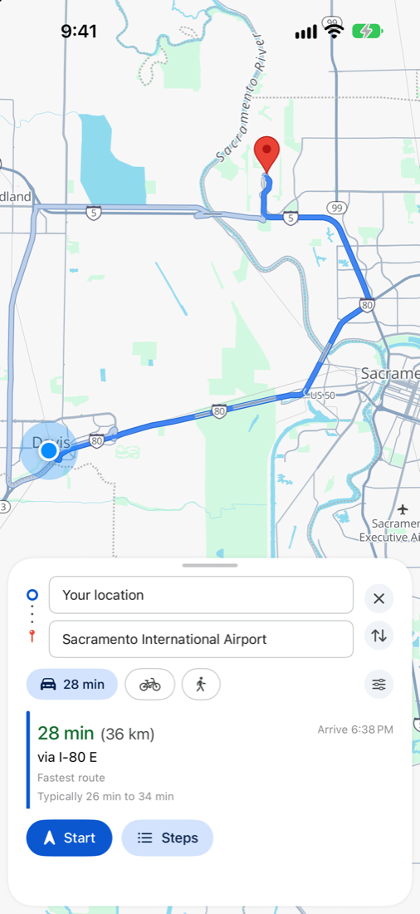 |

| Navigation | Navigation, dark |
|:-:|:-:|
| 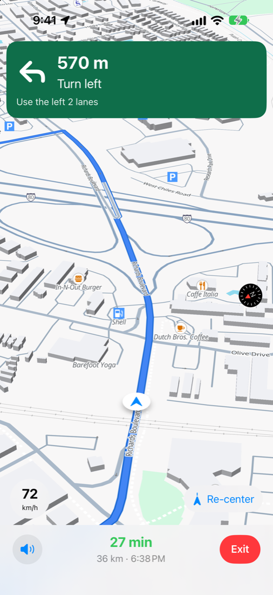 | 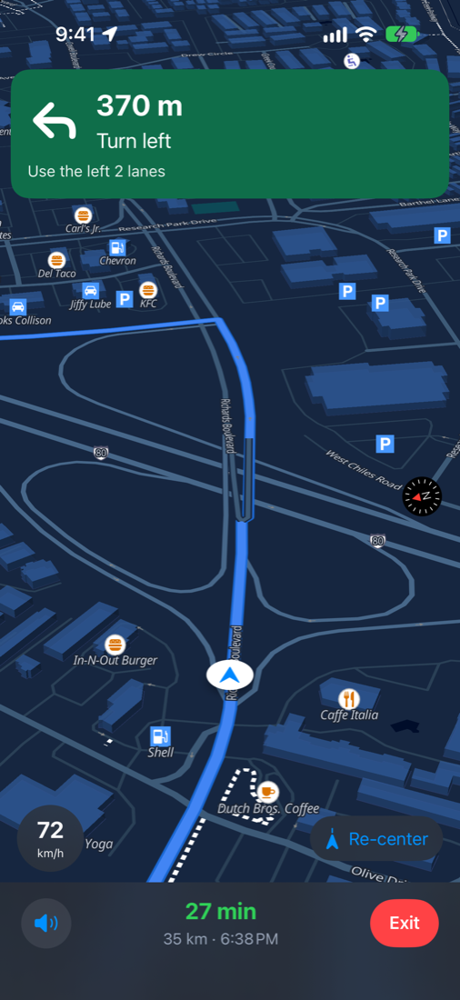 |

| Landscape results | Landscape navigation |
|:-:|:-:|
| 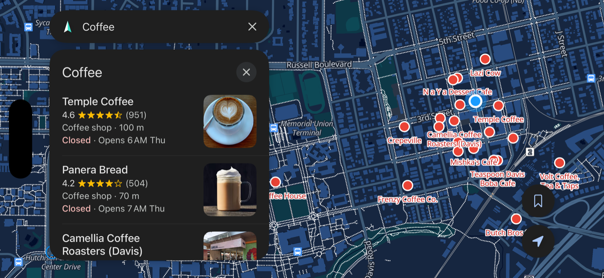 | 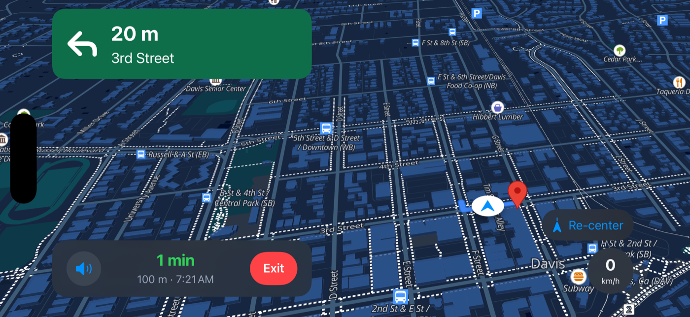 |

*Screenshots are taken in the simulator on the Davis, California fixture.*

## What works

- Map: OpenFreeMap's Liberty style through MapLibre Native, repainted in the Android app's
  sampled light and dark palettes (`Map/MapStyle.swift`). Follows the system appearance.
- Search: Google's keyless map search and its search-as-you-type answer, with ratings, review
  counts, open or closed status, price, photos and distance. Category chips. A second request over
  a tight window round the user leads the list, as on Android.
- Places: Hours with holiday labels, departments, phone, website, booking links, editorial
  summary, the About attributes, the featured review and share links. Tap a map label to look a
  place up. Long-press the map to drop a pin, named by Nominatim.
- Saved: Favorites, Want to go and Starred places, plus lists of your own. Home and Work, one
  tap from search and from the directions picker. Recents.
- Directions: Drive, bicycle and walk. A driving route is Google's line with live traffic,
  the typical time range and up to three alternates, colored by congestion. Its turns come from
  the FOSSGIS OSRM router, routed along Google's line through bearing-locked vias, so the
  instructions are OpenStreetMap's own on Google's course. When the two disagree on length by
  more than 7%, Google's own steps are used. Walking and cycling use OSRM. Avoid tolls, highways
  and ferries. Pick any start or end; location is not required.
- Landscape: Turn the phone on its side and search, the open panel and the drive banner move to
  a column on the left, with the map framed in the space beside it, as Google Maps does.
- Navigation: The progress window, anchor penalty, speed-scaled off-route corridor and
  three-hit reroute rule from SPEC 4.6, spoken prompts at speed-scaled distances with the turn
  after chained in, lane hints, a speed readout, arrival detection, background guidance and a
  traffic recheck every two minutes that switches to a route at least two minutes faster.

## Not ported yet

Offline maps and routing, transit, Street View, the full review feed and photo gallery, popular
times, shared-list and Takeout import, the Piper neural voice, CarPlay, the remote calibration
channel, settings and the interface translations.

## How it maps to the Android code

The Android engine cannot run on iOS: it depends on Android APIs, OkHttp, Rhino and the OsmAnd JVM
jars. The parts the iPhone needs were rewritten from the Kotlin sources and SPEC.md.

| iOS | Android |
| --- | --- |
| `Core/PJson.swift` | `core/data/google/GoogleResponse.kt` |
| `Core/Calibration.swift`, `CalibrationDefaults.swift` | `core/config/Calibration.kt`, `calibration.json` |
| `Google/RequestBuilders.swift` | `SearchPb.kt`, `DirectionsPb.kt`, `RequestShape.kt`, `BrowserViewport.kt` |
| `Google/SearchParser.swift` | `parse/SearchParser.kt`, `SuggestParser.kt` |
| `Google/DirectionsParser.swift` | `parse/DirectionsParser.kt` |
| `Google/GoogleTransport.swift` | `BrowserHeaders.kt`, `GoogleSession.kt`, the consent cookies in `CoreModule.kt` |
| `Routing/RouteService.swift` | `GoogleMapsDataSource.directions`, a reduced `HybridRoute` |
| `Nav/NavEngine.swift`, `NavSession.swift` | `core/nav/NavEngine.kt`, `NavSession.kt` |

`CalibrationDefaults.swift` is generated. After `calibration.json` changes, run:

```
python3 ios/scripts/gen-calibration.py
```

## Build

Needs a Mac with Xcode and [XcodeGen](https://github.com/yonaskolb/XcodeGen).

```
brew install xcodegen
cd ios
xcodegen generate
open Vela.xcodeproj
```

In `project.yml`, set `DEVELOPMENT_TEAM` to your own team and `PRODUCT_BUNDLE_IDENTIFIER` to an
identifier you own, then run `xcodegen generate` again.

### On your own iPhone, with a free Apple ID

1. Xcode > Settings > Accounts: sign in with your Apple ID.
2. Plug the iPhone in, turn on Developer Mode (Settings > Privacy & Security), pick it as the run
   destination and press Run.
3. On the phone: Settings > General > VPN & Device Management, tap your Apple ID, Trust.

A free account's build stops opening after 7 days; run it from Xcode again to renew it.
TestFlight needs a paid Apple Developer Program membership.

### Driving it in the simulator

Debug builds write the route being navigated to the app's `Caches/last-route.txt`. Start a drive,
then play the route as the simulator's location:

```
xcrun simctl location booted start --speed=20 $(cat <path to last-route.txt>)
```

## License

GPLv3, the same as the rest of this repository. A GPL app and the App Store's terms are a known
conflict, so this port is built for sideloading and TestFlight, not a public store listing.
